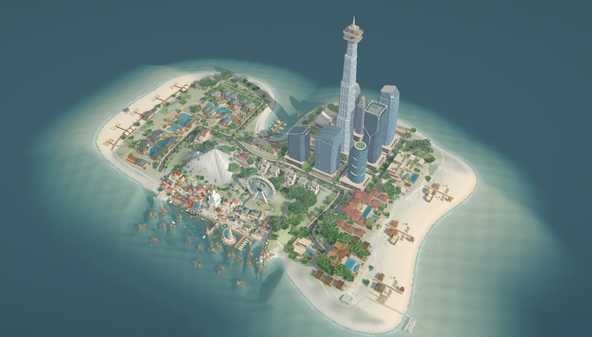
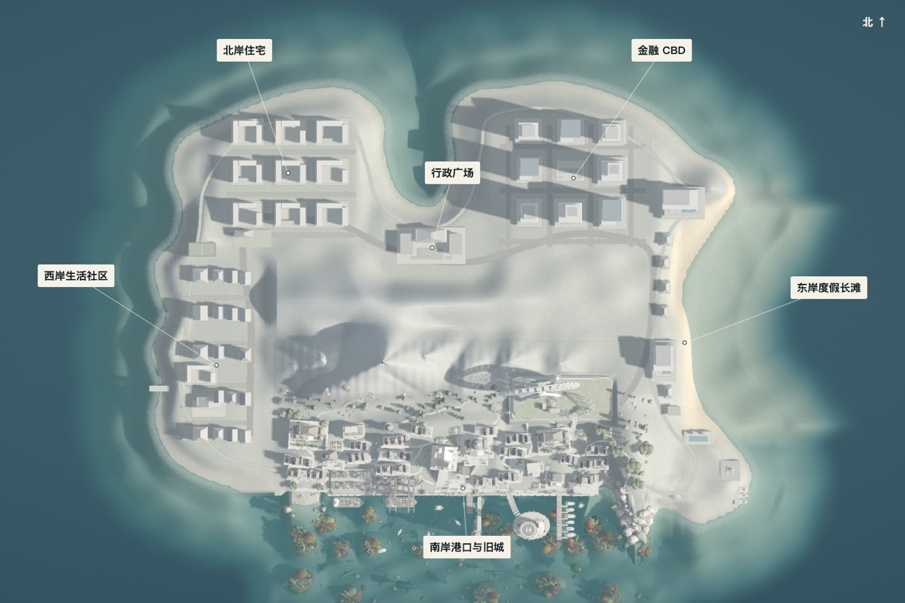
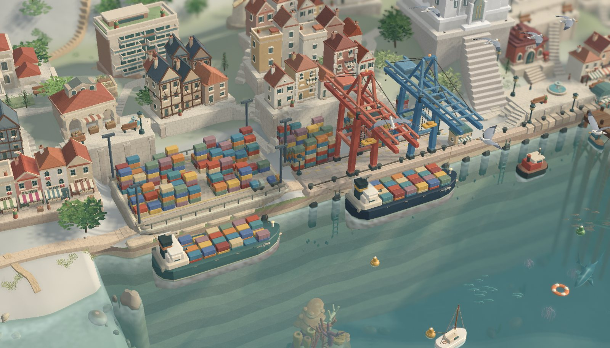
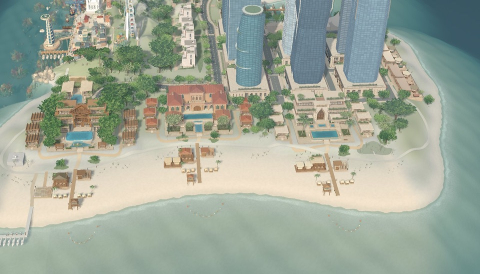
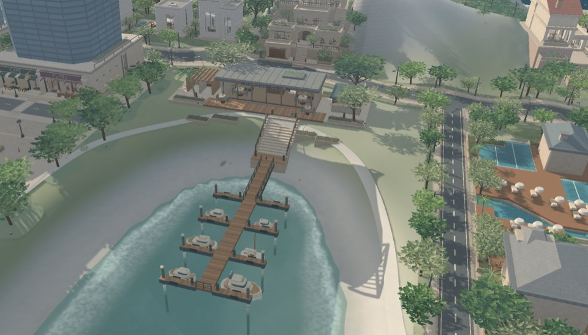
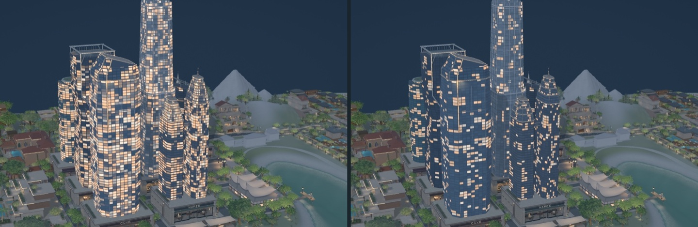
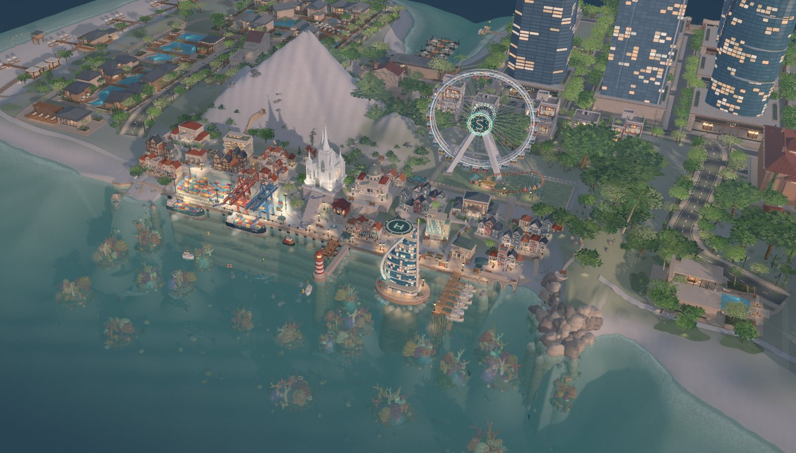

# S Village

**从一座港口开始，造一个能运行的 3D 世界。**

S Village 是一座可以在浏览器中探索的微缩岛屿。货船进港，岸吊把集装箱从甲板移到堆场。沿着海岸转动镜头，可以从南岸老城来到东岸长滩、峡湾游艇港和北岸金融区。把镜头拉近水面，还能看见浅海珊瑚礁。入夜以后，窗灯、街灯和船灯共同改变这座岛的面貌。

这是一个用 Codex 逐轮建模、运行和验收的案例。仓库提供六段可直接交给 Agent 的提示词、记录设计取舍的 SOP，以及从运行场景截取的画面。

[快速开始](#快速开始) · [全岛建模分阶段提示词][prompts] · [制作与迭代 SOP][sop]

## 快速开始

1. **从 Harbor Jelly 开工。** 在自己的工程里，将分阶段提示词的第 1 段完整交给 Codex，或其他能编辑代码并运行浏览器的 Agent。先做出一艘船、一台岸吊和一次完整的货柜交接。[打开第一阶段提示词][harbor]
2. **在同一工程里扩岛。** 打开第一阶段成果，试过进港、装卸、离港与返回，再把第 2 段交给 Agent。沿用原港口的坐标、海面基准和作业范围，先用白模定下地形、分区和道路。[打开整岛白模提示词][massing]
3. **逐区深化，再统一验收。** 总规确定后，北岸、东岸和西岸可按项目优先级推进。每次交接都保留上一阶段的可运行成果、与相邻区的连接点及验收机位。最后统一昼夜、天气、生态与全岛导览。[查看六阶段提示词][prompts]

**按提示词复现**时，每段复制对应代码块即可。**做自己的小世界**时，可以沿用这套阶段划分和检查方法，从自己的场地、路线和核心动作起步。[制作与迭代 SOP][sop]

## 六个阶段，每一步都能打开检查

| 阶段 | 这一轮做好什么 | 打开后先检查什么 |
| --- | --- | --- |
| [1. 南岸港口][harbor] | 航线、泊位、岸吊、堆场和微缩小镇 | 货柜从船到岸的交接，船舶离港、回港和场景复位 |
| [2. 整岛总规][massing] | 四面环海的白模、道路、分区、海岸与高差 | 俯视看分区和入口，低斜视看道路、台地和岸线是否接得上 |
| [3. 北岸金融区][finance] | 地标塔、临街底商、广场与滨水步道 | 远看天际线，近看店铺入口、橱窗和人行道净宽 |
| [4. 东岸度假湾][resorts] | 长滩、酒店、泳池、步道和海滨设施 | 从酒店入口一路看到下水点，核对泳区与游艇航线之间的距离 |
| [5. 西岸与峡湾][west] | 低层住宅、公共花园、滨海慢行和私人艇港 | 从住区到水边的路线，以及高潮、低潮时坡道和浮桥的衔接 |
| [6. 全岛整合][integration] | 统一的环境、活动、连续运镜与离线版本 | 走完一条全岛导览，切换环境，再复测原港口的核心操作 |

*早期整岛白模。原港口作为南岸锚点，新的地块、山脊与海岸先在总图上接起来，再深化立面和夜景。*

## 岛屿是怎样一步步做出来的

### 先让码头真正运转

岸吊必须等货船停稳，再对位、锁箱、起升和落箱。货柜在船、吊具和堆场之间交接时，每一刻都归属于一个位置。这样即使之后加入第二台吊机、拖船和更多岸上设施，仍能用同一条装卸与回港流程复查改动。

### 用连续的路线组织建筑

东岸从酒店入口经泳池露台和步道通向沙滩，西岸从住区经花园和岸台走到水边。峡湾游艇港把石阶、坡道与随潮升降的浮桥接成一条路线。看总图时，路线把分区连在一起。拉近之后，可以核对每段台阶、坡道和入口的落点。

| 东岸度假带 | 峡湾私人游艇港 |
| --- | --- |
|  |  |

### 用同一机位判断改动

北岸的第一版夜景亮窗太密，几栋塔楼在远处看起来像一片亮面。回到同一机位减少亮窗、保留暗窗分组后，塔冠与各栋楼的轮廓更容易分辨。再切到街面，单独看橱窗、入口和路灯能不能让人读懂步行路线。

### 让访客能自由接管镜头

全岛导览把各区的机位串成连续运镜，跨区时抬高视角越过高楼，抵达后回到局部构图。访客可以随时停止导览，亲自调整视角，或把找到的机位保存下来并按顺序回放。切换时段、天气和季节时，可以留在原机位观察同一个地点的变化。

## Agent 与 Three.js 能带来什么

当场地、构件、行为和机位都能用代码表达，空间原型就能随问题一起演进。团队可以在同一场景里比较两套入口方案，走一遍参观路线，或者按下操作按钮，看设备的动作顺序是否讲得通。每次迭代都能留下可回看的画面，也能复验受影响的行为。

- **Agent 负责把意图变成可检查的改动。** 设计者给出具体地点、尺度、行为和验收机位，Agent 编写几何与交互逻辑、运行浏览器并回到这些机位检查。空间关系、使用体验和每轮优先级由设计者判断。
- **Three.js 可以承接浏览器里的 3D 实现。** 用场景图组织地块、建筑和设备，用共享几何和材质复用构件，再接入相机、点选和动画。S Village 成品采用原生 WebGPU 与 WGSL。用 Three.js 复现时，可以沿用同一份布局和行为规则，改用 Three.js 实现场景和渲染。[Three.js 官方文档](https://threejs.org/docs/)

### 从相同的工作流起步

| 你要做的项目 | 第一个可验证的原型 |
| --- | --- |
| 建筑与园区方案 | 在同一机位切换两套体量和入口方案，比较步行距离、视线和阴影。 |
| 文旅与品牌体验 | 做一条从鸟瞰进入建筑或展陈的路线，让访客能中途停下来自由探索。 |
| 科普与流程演示 | 让观众亲手完成靠泊、吊装和离港，理解设备在什么时候接力。 |
| 游戏与互动叙事 | 先搭一个街区、一条可达路线和一个可触发事件，再扩展角色与环境。 |

## 用 Three.js 开始自己的版本

把下方这段加在当前阶段的提示词末尾，指定实现方式。

> 这一阶段用 Three.js 构建场景、相机、材质与渲染。把布局参数和船舶、岸吊、货柜的状态独立于渲染对象，沿用阶段提示词里的坐标、路径与验收标准。先完成可在浏览器运行的最小版本，再继续深化。将运行依赖和资源一同打包，用最终交付物验证断网打开。

后续每次修改，给 Agent 一个地点或机位、一条能观察到的问题和一个验收动作。例如「在峡湾低机位检查最低潮时坡道与浮桥的落点，调整后复跑高低潮各一次」。[可复制的修改模板][revision]

[prompts]: S%20Village%20%E5%85%A8%E5%B2%9B%E5%BB%BA%E6%A8%A1%E5%88%86%E9%98%B6%E6%AE%B5%E6%8F%90%E7%A4%BA%E8%AF%8D.md
[sop]: S%20Village%20%E5%88%B6%E4%BD%9C%E4%B8%8E%E8%BF%AD%E4%BB%A3%20SOP.md
[harbor]: S%20Village%20%E5%85%A8%E5%B2%9B%E5%BB%BA%E6%A8%A1%E5%88%86%E9%98%B6%E6%AE%B5%E6%8F%90%E7%A4%BA%E8%AF%8D.md#1-从零建立南岸港口
[massing]: S%20Village%20%E5%85%A8%E5%B2%9B%E5%BB%BA%E6%A8%A1%E5%88%86%E9%98%B6%E6%AE%B5%E6%8F%90%E7%A4%BA%E8%AF%8D.md#2-以南岸港口为锚点搭整岛白模
[finance]: S%20Village%20%E5%85%A8%E5%B2%9B%E5%BB%BA%E6%A8%A1%E5%88%86%E9%98%B6%E6%AE%B5%E6%8F%90%E7%A4%BA%E8%AF%8D.md#3-建北岸金融区与滨水公共空间
[resorts]: S%20Village%20%E5%85%A8%E5%B2%9B%E5%BB%BA%E6%A8%A1%E5%88%86%E9%98%B6%E6%AE%B5%E6%8F%90%E7%A4%BA%E8%AF%8D.md#4-建东岸度假湾与连续长滩
[west]: S%20Village%20%E5%85%A8%E5%B2%9B%E5%BB%BA%E6%A8%A1%E5%88%86%E9%98%B6%E6%AE%B5%E6%8F%90%E7%A4%BA%E8%AF%8D.md#5-建西岸生活社区与峡湾游艇港
[integration]: S%20Village%20%E5%85%A8%E5%B2%9B%E5%BB%BA%E6%A8%A1%E5%88%86%E9%98%B6%E6%AE%B5%E6%8F%90%E7%A4%BA%E8%AF%8D.md#6-整合全岛环境生态与漫游
[revision]: S%20Village%20%E5%85%A8%E5%B2%9B%E5%BB%BA%E6%A8%A1%E5%88%86%E9%98%B6%E6%AE%B5%E6%8F%90%E7%A4%BA%E8%AF%8D.md#做完任一阶段后怎么提修改
